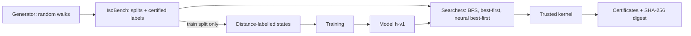
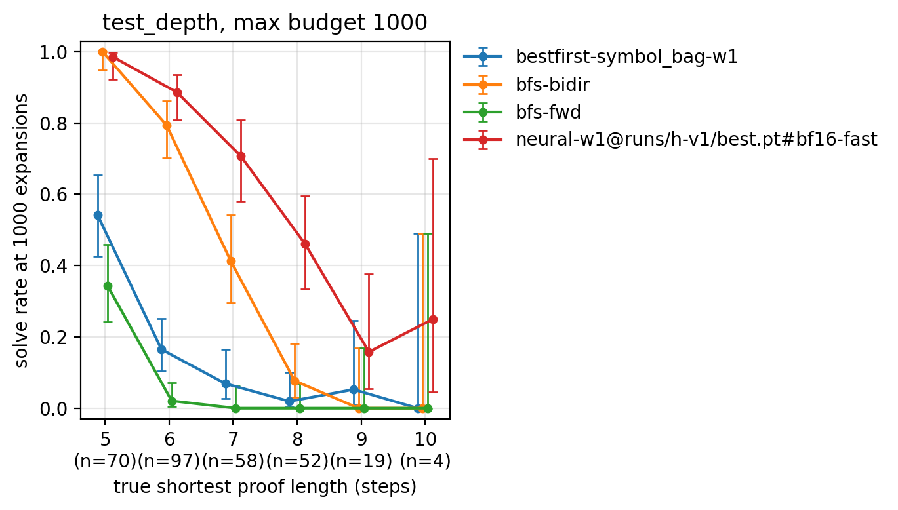

# Isomer: Learned Search for Machine-Checked Equational Proofs

Isomer proves equations in algebraic theories by searching over rewrite steps. A small transformer, trained to estimate how many steps remain, guides the search. Every proof is replayed by a tiny trusted kernel that shares no code with the search or the model.

[](https://github.com/Yashas2004/isomer/actions/workflows/ci.yml)
[](LICENSE)

[](https://github.com/Yashas2004/isomer/releases/tag/v0.2-e2)

> **Headline (pre-registered, kernel-checked).** On problems whose shortest proofs (5–10 steps) are longer than any proof seen in training (distances up to 4), learned guidance solves **74.7%** within 1,000 expansions. The hand-written symbol_bag heuristic solves **20.0%** and bidirectional BFS **58.3%**. Every problem symbol_bag solved, the learned heuristic also solved, at every budget (Holm p ≤ 1.4e-38).
>
> **What it does not do:** it does not transfer to theories it never saw. On held-out lattice and ring it ties symbol_bag, and at equal wall-clock time it is slower there.

---

## What it is

Given the axioms of a theory (group, boolean algebra, lattice, ring) and two terms `s` and `t`, Isomer searches for a sequence of rewrite steps that turns `s` into `t`. Each step uses one axiom, in either direction, at one position, sometimes with a chosen instantiation. The proof becomes a JSON certificate that the kernel replays independently.



- **IsoBench** is a deterministic benchmark built from random walks. Each problem is labelled with its shortest proof length by bidirectional BFS, with certified bounds.
- **Searchers:** forward and bidirectional BFS, best-first search with hand-written heuristics, and best-first search guided by the learned model.
- **The learned model** scores (state, goal) pairs by estimated remaining distance. It is trained only on states from the training split.

## System highlights

- **Learned distance heuristic.** A 6-layer transformer encoder with 4,731,649 trainable parameters (d=256, 8 heads, RoPE, RMSNorm, SwiGLU, segment embeddings). It reads a (state, goal) pair and predicts the remaining proof distance. Training combines a Huber regression loss with a listwise ranking loss over a state's successors, whose soft target spreads over *all* optimal children. Training data: 551,072 distance-labelled states, 20 epochs, peak 3.0 GB of GPU memory on a 6 GB laptop RTX 3050 (bf16, micro-batched).
- **Neural best-first search.** Each expansion scores all of a node's children in one batch. Inference is deterministic, with an fp32 mode and a bf16-fast mode (2.24× faster, pinned by golden fp32 tests).
- **Trusted proof kernel.** `core/kernel.py` is 141 lines and imports nothing from the rewriting, search, data or model code (the de Bruijn criterion, [ADR-001](docs/adr/001-trusted-kernel.md)). Each proof is a JSON certificate with a SHA-256 digest that the kernel replays from the axioms. A proof counts only if the kernel accepts it.
- **Symmetric action space.** Each step uses one axiom, in either direction, at one position, with instantiations drawn from a problem-level pool. Forward and backward search therefore see exactly the same graph, so bidirectional BFS distances are exact ([ADR-003](docs/adr/003-symmetric-action-space.md)).
- **IsoBench v2.** A deterministic benchmark (byte-identical rebuilds) of about 35k problems over group, boolean algebra, lattice and ring. Every label carries certified bounds `dist_lb ≤ dist ≤ dist_ub`. The evaluation splits are labelled with 20,000 expansions, 20× the largest benchmark budget, so the labeller does not grade itself ([ADR-004](docs/adr/004-isobench-v2.md)).
- **Pre-registered evaluation.** Plans, predictions and stratified problem samples are committed before any test search. The analysis uses exact McNemar tests with Holm correction, Wilson intervals, a fair optimality gap, and equal-time comparisons with explicit censoring. Falsified predictions are reported as falsified.

## Architecture

How the modules connect (the pipeline view is the diagram above):

```text
                     +----------------------------------+
                     |  CLI: python -m isomer <command> |
                     |  prove · data · states · train   |
                     |  bench · report · timecompare    |
                     +----------------+-----------------+
                                      |
             +------------------------+-----------------+
             v                                          v
+--------------------------+               +--------------------------+
| IsoBench builder (data/) |   problems    | Search (search/)         |
| random walks, 4 theories |-------------->| bfs-fwd, bfs-bidir       |
| bidir-BFS labels with    |               | best-first: size_diff,   |
|   certified bounds       |        +----->|   symbol_bag             |
| train / eval / held-out  |        |      | neural best-first        |
+--------------------------+        |      +--------------------------+
             |                      |                   |
             | train split only     |  h(state, goal)   | proof steps
             v                      |                   v
+--------------------------+        |      +--------------------------+
| Learning (learn/)        |        |      | Trusted kernel (core/)   |
| distance-labelled states |        |      | 141 lines, imports no    |
| tokenizer + transformer  |--------+      |   search/data/model code |
| Huber + listwise ranking | checkpoint    | replays JSON certificate |
| bf16, fits a 4 GB GPU    |   h-v1        | -> ACCEPTED / REJECTED   |
+--------------------------+               +--------------------------+
                                                        |
                                                        | accepted proofs only
                                                        v
                                           +--------------------------+
                                           | Benchmark (bench/)       |
                                           | prefix-property runs     |
                                           | McNemar + Holm, Wilson   |
                                           | equal-time analysis      |
                                           +--------------------------+
```

## Results

**E2: learned heuristic vs baselines on IsoBench v2.** Solve rate at 1,000 node expansions; only kernel-accepted proofs count. Plan: [docs/experiments/E2-learned-heuristic.md](docs/experiments/E2-learned-heuristic.md). Full results: [docs/results/E2](docs/results/E2/README.md).

| split | what it tests | neural-w1 (learned) | best-first symbol_bag | bfs-fwd | bfs-bidir |
|---|---|---:|---:|---:|---:|
| test_id (n=300) | dist 1–4, like training | **100.0%** | 93.0% | 91.3% | 100%\* |
| test_depth (n=300) | dist 5–10, longer than training | **74.7%** | 20.0% | 8.7% | 58.3% |
| test_deep (n=100) | certified lower bound 7–11 | 2/100 | 0/100 | 0/100 | 0/100 |
| test_theory (n=300) | held-out lattice + ring | 56.3% | 55.3% | 46.3% | **80.3%** |

\* test_id was labelled by bfs-bidir, so that cell is reported but not interpreted.



| finding (test_depth unless stated) | value |
|---|---|
| Solve rate at 30 expansions, learned vs symbol_bag at 10,000 | 46.3% vs 41.0% |
| Solve rate by true distance 5 / 6 / 7 / 8 / 9 | 69/70 · 86/97 · 41/58 · 24/52 · 3/19 |
| Fair optimality gap (1.000 = always shortest) | 1.000 learned vs 1.200 symbol_bag |
| Median nodes stored when solved | 374 learned vs 6,887 symbol_bag |
| Equal wall-clock, 1 s per problem | 50.3% learned vs 18.0% symbol_bag |
| Equal wall-clock on test_theory | symbol_bag significantly better at every limit (1–30 s) |

**Pre-registered predictions:** 3 confirmed and 2 falsified. Falsified: (1) on test_id the learned heuristic is significantly *better*, not tied at the ceiling; (2) at 1 s per problem it already beats symbol_bag, where we predicted symbol_bag would be at least as good.

**E1: non-neural baselines on IsoBench v1** ([plan](docs/experiments/E1-baselines.md), [results](docs/results/E1/README.md)). The crude goal-directed heuristic symbol_bag beats forward BFS (582 vs 284 solved on test_depth at 3,000 expansions), which falsified the prediction that no heuristic would be significantly better. It costs proof length (gap 1.168). E1 also exposed a circular labeller, which led to the decoupled labels in IsoBench v2.

## Installation

Requirements: Windows or Linux, Python 3.10–3.12, PyTorch 2.x. An NVIDIA GPU is optional; the searchers that need no model run without PyTorch.

```bash
git clone https://github.com/Yashas2004/isomer.git
cd isomer
python -m venv .venv
.venv\Scripts\activate            # Linux/macOS: source .venv/bin/activate
python -m pip install --upgrade pip

# PyTorch: pick the right command at https://pytorch.org/get-started/locally/
pip install torch --index-url https://download.pytorch.org/whl/cu126
pip install -e ".[dev,plots]"

python -m isomer doctor           # checks Python, torch, CUDA, bf16
```

Download the trained checkpoint (release [v0.2-e2](https://github.com/Yashas2004/isomer/releases/tag/v0.2-e2), sha256 `928015f6250a8531e6249e799507d4ca8bd433e50e28b7639aae6fa885376c00`):

```powershell
# Windows (PowerShell)
New-Item -ItemType Directory -Force runs/h-v1
Invoke-WebRequest https://github.com/Yashas2004/isomer/releases/download/v0.2-e2/best.pt -OutFile runs/h-v1/best.pt
certutil -hashfile runs/h-v1/best.pt SHA256
```
```bash
# Linux/macOS
mkdir -p runs/h-v1
curl -L -o runs/h-v1/best.pt https://github.com/Yashas2004/isomer/releases/download/v0.2-e2/best.pt
sha256sum runs/h-v1/best.pt
```

## Quickstart

```bash
python -m isomer prove --example bool-deep                                   # learned search, kernel-checked
python -m isomer prove --example bool-deep --method bestfirst-symbol_bag-w1  # same problem, hand-written heuristic
python -m isomer prove --theory group --lhs "(* e (* (inv a) a))" --rhs "e" --cert proof.json
```

`prove` prints each rewrite step, the search statistics and the kernel's verdict. The default method is `neural-w1` with `runs/h-v1/best.pt`, in bf16-fast on CUDA and fp32 on CPU. The other methods (`bestfirst-symbol_bag-w1`, `bfs-bidir`, `bfs-fwd`, ...) need neither a checkpoint nor torch. It exits with 0 if a proof is found and accepted, 1 if there is no proof within budget, and 2 on an error. On an idle laptop GPU, `bool-deep` gives a 6-step proof in 6 expansions (about 0.1 s after a one-time model load of about 4 s); symbol_bag finds no proof within 1,000 expansions.

The built-in examples (`group-short`, `bool-deep`, `lattice`) were hand-picked from the dev set, which is disjoint from the benchmark, to show the learned search working. They are illustrations, not evidence. The evidence is the E2 table above.

## CLI reference

| command | what it does |
|---|---|
| `doctor` | report Python, PyTorch, CUDA and bf16 support |
| `demo` | kernel-check a hand-written 2-step group proof (smoke test, no model needed) |
| `prove` | prove one equation (`--example` or `--theory/--lhs/--rhs`), with any `--method`, and optionally write a `--cert` |
| `sample` | print random-walk problems for a theory |
| `data` | build IsoBench v2 (deterministic; `--workers`) |
| `states` | build distance-labelled training states from the train split only |
| `train` | train the distance heuristic (`--states`, `--out`, `--epochs`, model size flags) |
| `stratify` | draw a fixed stratified sample of problem ids for a pre-registered experiment |
| `bench` | run searchers on a split at several budgets and kernel-check every proof |
| `report` | write results.md, statistics and figures from a bench run (no re-running) |
| `timecompare` | equal-wall-clock analysis from a main run and a time run |

Method names: `bfs-fwd`, `bfs-bidir`, `bestfirst-size_diff-w1`, `bestfirst-symbol_bag-w1`, and `neural-w1@<checkpoint>#<precision>` (for example `neural-w1@runs/h-v1/best.pt#bf16-fast`).

## Reproducing the paper numbers

Measured on one Windows laptop (16 logical CPUs, RTX 3050 6GB Laptop GPU).

| step | command | measured time |
|---|---|---:|
| 1. Build IsoBench v2 | `python -m isomer data --workers N` | 6,283 s |
| 2. Training states | `python -m isomer states --workers N` | 1,050 s |
| 3. Train h-v1 | `python -m isomer train --states data/states-v2 --out runs/h-v1 --epochs 20` | ~9,040 s |
| 4. E2 main run (4 splits) | see below | 8,136 s |
| 5. E2 equal-time run (4 splits) | see below | 5,010 s |

The labelling workers can peak at about 2.3 GiB each (1.5M-node cap), so choose `--workers ≤ free RAM in GiB / 2.3`. The stratified samples are committed in `docs/experiments/E2/`. For each split `S` in `test_id`, `test_depth`, `test_deep` and `test_theory`:

```powershell
python -m isomer bench --data data/isobench-v2 --split S --ids docs/experiments/E2/ids-S.txt `
  --methods "bfs-fwd,bfs-bidir,bestfirst-symbol_bag-w1,neural-w1@runs/h-v1/best.pt#bf16-fast" `
  --budgets 30,100,300,1000 --workers 2 --out runs/E2-S
python -m isomer bench --data data/isobench-v2 --split S --ids docs/experiments/E2/ids-S.txt `
  --methods bfs-fwd,bestfirst-symbol_bag-w1 --budgets 1000,3000,10000 --max-nodes 1500000 `
  --workers 4 --out runs/E2time-S
python -m isomer report runs/E2-S --reference bestfirst-symbol_bag-w1
python -m isomer timecompare --main runs/E2-S --time runs/E2time-S --out runs/E2-S/report
```

Measured E2 wall time per split (elapsed time printed by bench at 100%):

| | test_id | test_depth | test_deep | test_theory | total |
|---|---:|---:|---:|---:|---:|
| main run (2 workers, one GPU) | 109 s | 1,674 s | 2,328 s | 4,025 s | 8,136 s (~2.3 h) |
| equal-time run (4 CPU workers) | 85 s | 2,216 s | 1,014 s | 1,695 s | 5,010 s (~1.4 h) |

`report` and `timecompare` only read logs; each takes seconds. Every run records its git commit and `git_dirty: false` in `config.json`.

## Why trust the numbers

- **Kernel gate.** The benchmark runner rebuilds each certificate from the dataset record's own goal and runs the kernel on it. A rejected proof makes the run fail loudly; it is never silently counted.
- **No circular labels.** The evaluation labels come from a 20× larger budget than any benchmark run; the runner warns when a budget comes within 10× of the labelling budget.
- **Frozen before testing.** Questions, predictions, analysis and problem ids were committed before any search on the test splits (E2 plan at commit `cd3d517`).
- **Paired statistics.** Exact McNemar tests with Holm correction; the optimality gap is computed only on problems that every method solved.
- **Determinism tests.** Byte-identical dataset rebuilds; deterministic neural search on CPU and CUDA; the prefix property (one run gives the results for every smaller budget) is tested for every searcher; golden fp32 outputs pin the model. The suite has 225 tests, and CI runs on Ubuntu and Windows with Python 3.10 and 3.12.

## Limitations

- **Synthetic benchmark.** The problems are random-walk identities in four small theories, with no external benchmark (TPTP UEQ is not evaluated yet).
- **No cross-theory transfer.** The model ties symbol_bag on held-out lattice and ring, and is slower there at equal time.
- **Depth decay.** Success falls with proof length beyond the training range; certified-deep problems are essentially unsolved by every method.
- **Small model, one signal.** 4.7M parameters and a value-style distance head; there is no policy head.
- **Pure Python, one machine.** Absolute speeds are far from optimised provers. The wall-clock comparisons depend on the hardware: the neural searcher ran with 2 workers sharing one laptop GPU, the baselines with 4 CPU workers.
- **Input length untested.** Too few searches reached states longer than the training inputs (126 tokens) to say whether the model handles longer inputs.
- **Not done yet:** e-graph / equality-saturation baselines, expert iteration, ablations and interpretability. See the roadmap in [docs/DESIGN.md](docs/DESIGN.md).

## Documentation

| document | contents |
|---|---|
| [docs/DESIGN.md](docs/DESIGN.md) | research questions, architecture, roadmap with status |
| [ADR-001](docs/adr/001-trusted-kernel.md) | a tiny trusted kernel, independent of all search and model code |
| [ADR-002](docs/adr/002-action-space-and-labels.md) | the action space (both directions, instantiation) and difficulty labels |
| [ADR-003](docs/adr/003-symmetric-action-space.md) | a symmetric problem-level instantiation pool |
| [ADR-004](docs/adr/004-isobench-v2.md) | IsoBench v2: separate pools, decoupled labels, memory cap, certified bounds |
| [E1 plan](docs/experiments/E1-baselines.md) · [results](docs/results/E1/README.md) | non-neural baselines |
| [E2 plan](docs/experiments/E2-learned-heuristic.md) · [results](docs/results/E2/README.md) | learned heuristic vs baselines |
| [train-h-v1](docs/results/train-h-v1/) | training config, metrics and checkpoint hash |
| [docs/datasets/](docs/datasets/) | datasheets for every IsoBench version |

## Repository layout

```
src/isomer/core/      terms, rewriting (untrusted), kernel (trusted), certificates, theories, generator
src/isomer/search/    BFS (forward, bidirectional), best-first + heuristics, neural best-first
src/isomer/data/      IsoBench builder, stratified sampling
src/isomer/learn/     states, tokenizer, model, training, batched inference
src/isomer/bench/     kernel-checked benchmark runner, report, equal-time analysis
src/isomer/demo.py    `isomer prove`
tests/                pytest suite
docs/                 design, ADRs, pre-registered plans, results, datasheets
```

## Citation

If you use Isomer or IsoBench, please cite:

```bibtex
@software{isomer2026,
  author = {Yashas R},
  title  = {Isomer: Learned Search for Machine-Checked Equational Proofs},
  year   = {2026},
  url    = {https://github.com/Yashas2004/isomer}
}
```

## License

MIT, see [LICENSE](LICENSE).
