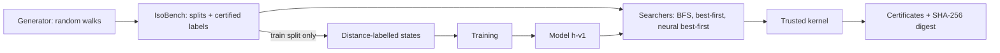

# Isomer

Machine-checked equational proofs, found by best-first search guided by a small learned distance heuristic, and checked by a tiny independent kernel.

[](https://github.com/Yashas2004/isomer/actions/workflows/ci.yml)

## Headline result

On proofs longer than any seen in training (test_depth: shortest proofs of 5–10 steps; the model was trained on distances up to 4), best-first search guided by the learned heuristic (h-v1, 4.7M parameters) solves **74.7%** of problems within 1,000 node expansions. The same search guided by the hand-written symbol_bag heuristic solves 20.0%, and bidirectional BFS 58.3%. Every problem that symbol_bag solved, the learned heuristic also solved, at all four budgets tested.

**It does not transfer to held-out theories.** On lattice and ring, which were never seen in training, it is no better than symbol_bag. At equal wall-clock time the baselines are significantly better there, because each neural expansion costs more.

| solve rate at 1,000 expansions | neural-w1 (learned) | bestfirst-symbol_bag-w1 | bfs-bidir |
|---|---:|---:|---:|
| test_depth (dist 5–10, n=300) | **74.7%** | 20.0% | 58.3% |
| test_theory (held-out lattice + ring, n=300) | 56.3% | 55.3% | **80.3%** |


The numbers come from a pre-registered experiment ([plan](docs/experiments/E2-learned-heuristic.md), [results](docs/results/E2/README.md)). Every proof counted was accepted by the trusted kernel.

## What it is

Given the axioms of a theory (group, boolean algebra, lattice, ring) and two terms `s` and `t`, Isomer searches for a sequence of rewrite steps that turns `s` into `t`. Each step is one axiom, used in either direction, at one position, and sometimes with a chosen instantiation. A proof becomes a JSON certificate that a ~150-line kernel replays independently.

- **IsoBench** is a deterministic benchmark built from random walks. Each problem is labelled with its shortest proof length by bidirectional BFS, and every label carries certified bounds.
- **Searchers:** forward and bidirectional BFS, best-first search with hand-written heuristics, and best-first search guided by a learned model.
- **The learned model** is a transformer that scores (state, goal) pairs by estimated remaining distance. It is trained on distance-labelled states taken from the training split only.



## Why trust the numbers

- **Trusted kernel, independent of search.** `core/kernel.py` imports none of the rewriting, search, data or model code ([ADR-001](docs/adr/001-trusted-kernel.md)). The benchmark runner rebuilds each certificate from the dataset record's own goal and runs the kernel on it. Only accepted proofs count; a rejected proof makes the run fail loudly.
- **Certified labels.** Every record carries `dist_lb ≤ dist ≤ dist_ub`. The lower bound is proven from completed BFS layers, and test_deep is graded only by that certified bound ([ADR-004](docs/adr/004-isobench-v2.md)).
- **Labels decoupled from benchmark budgets.** E1 found that the labeller (bidirectional BFS) had the same budget as the benchmark, which made its own results circular. The v2 evaluation splits are labelled with 20,000 expansions (test_id with 3,000), at least 20× the largest benchmark budget on test_depth, test_deep and test_theory. The runner warns when budgets come within 10× of the labelling budget.
- **Pre-registered experiments.** Questions, setup, analysis and predictions were frozen and committed before any search on the test splits. The predictions are graded in the results, including the falsified ones. Problem samples are stratified, fixed and committed (`docs/experiments/E2/ids-*.txt`).
- **Paired statistics:** exact McNemar tests with Holm correction, and Wilson intervals. The optimality gap is "fair": it is computed only on problems every method solved.
- **Reproducibility tests:** dataset builds are byte-identical; neural search is deterministic (CUDA and CPU); the prefix property, that one run gives the results at every smaller budget, is tested for every searcher; golden fp32 outputs pin the model. Runs are made from a clean committed tree (`git_dirty: false` in every config.json).

## Quickstart

Windows or Linux, Python 3.10–3.12, optionally an NVIDIA GPU.

```powershell
python -m venv .venv
.venv\Scripts\activate                       # Linux: source .venv/bin/activate
python -m pip install --upgrade pip
# PyTorch with CUDA (exact command: https://pytorch.org/get-started/locally/), e.g.
pip install torch --index-url https://download.pytorch.org/whl/cu126
pip install -e ".[dev,plots]"
python -m isomer doctor                      # Python, torch, GPU, bf16

# The trained checkpoint (release v0.2-e2),
# sha256 928015f6250a8531e6249e799507d4ca8bd433e50e28b7639aae6fa885376c00
New-Item -ItemType Directory -Force runs/h-v1
Invoke-WebRequest https://github.com/Yashas2004/isomer/releases/download/v0.2-e2/best.pt -OutFile runs/h-v1/best.pt
certutil -hashfile runs/h-v1/best.pt SHA256
# Linux: mkdir -p runs/h-v1 && curl -L -o runs/h-v1/best.pt <url above> && sha256sum runs/h-v1/best.pt

python -m isomer prove --example bool-deep
python -m isomer prove --example bool-deep --method bestfirst-symbol_bag-w1   # the baseline, for comparison
python -m isomer prove --theory group --lhs "(* e (* (inv a) a))" --rhs "e" --cert proof.json
```

`prove` prints each rewrite step and the kernel's verdict on the certificate.
- **Default method:** `neural-w1` with `runs/h-v1/best.pt`, in bf16-fast on CUDA and fp32 on CPU.
- **Other methods:** `--method` takes `bestfirst-symbol_bag-w1`, `bfs-bidir`, `bfs-fwd`, ...; these need no checkpoint and no torch.

The three built-in examples are `group-short`, `bool-deep` and `lattice`. **They are illustrative only:** they were hand-picked from the dev set (`data/isobench-v2-dev`, disjoint from the benchmark) because neural-w1 succeeds on them (and, for bool-deep, symbol_bag does not). They are not evidence; the evidence is [docs/results/E2](docs/results/E2/README.md).

## Reproduce

The times below were measured on one Windows laptop (16 logical CPUs, RTX 3050 6GB Laptop GPU). They come from the logged datasheets, training metrics and per-problem seconds.

```powershell
# 1. IsoBench v2 into data/isobench-v2 (ADR-004). 6,283 s wall (datasheet seconds.total).
#    Each worker can peak at ~2.3 GiB (1.5M-node labelling cap): --workers <= free RAM in GiB / 2.3.
python -m isomer data --workers N

# 2. Distance-labelled states from train.jsonl only: 1,050 s (stats.json).
python -m isomer states --workers N

# 3. Train h-v1: 20 epochs, ~9,040 s (~2.5 h) on the GPU, peak 3.0 GB allocated (bf16, micro-batched).
python -m isomer train --states data/states-v2 --out runs/h-v1 --epochs 20

# 4. E2 (stratified samples are committed in docs/experiments/E2/; isomer stratify regenerates them).
#    Main run, per split S in test_id, test_depth, test_deep, test_theory:
python -m isomer bench --data data/isobench-v2 --split S --ids docs/experiments/E2/ids-S.txt `
  --methods "bfs-fwd,bfs-bidir,bestfirst-symbol_bag-w1,neural-w1@runs/h-v1/best.pt#bf16-fast" `
  --budgets 30,100,300,1000 --workers 2 --out runs/E2-S
#    Equal-time run (baselines with 10x the budget):
python -m isomer bench --data data/isobench-v2 --split S --ids docs/experiments/E2/ids-S.txt `
  --methods bfs-fwd,bestfirst-symbol_bag-w1 --budgets 1000,3000,10000 --max-nodes 1500000 `
  --workers 4 --out runs/E2time-S
python -m isomer report runs/E2-S --reference bestfirst-symbol_bag-w1
python -m isomer timecompare --main runs/E2-S --time runs/E2time-S --out runs/E2-S/report
```

Measured wall time (elapsed time printed by bench at 100%):

| | test_id | test_depth | test_deep | test_theory | total |
|---|---:|---:|---:|---:|---:|
| main run (2 workers, one GPU) | 109 s | 1,674 s | 2,328 s | 4,025 s | 8,136 s (~2.3 h) |
| equal-time run (4 CPU workers) | 85 s | 2,216 s | 1,014 s | 1,695 s | 5,010 s (~1.4 h) |

`report` and `timecompare` only read logs; each takes seconds.

## Results

- **E1, non-neural baselines on IsoBench v1:** [plan](docs/experiments/E1-baselines.md), [results](docs/results/E1/README.md).
  - The crude goal-directed heuristic symbol_bag beats forward BFS: on test_depth at 3,000 expansions it solves 582 problems vs 284. That falsified the pre-registered prediction that no heuristic would be significantly better.
  - It costs proof quality (fair optimality gap 1.168).
  - Bidirectional BFS was the labeller with the same budget as the benchmark, so its results were circular. This led to the decoupled labels in IsoBench v2.
- **Model training (h-v1):** [config and metrics](docs/results/train-h-v1/).
- **E2, learned heuristic vs baselines on IsoBench v2:** [plan](docs/experiments/E2-learned-heuristic.md), [results](docs/results/E2/README.md).
  - **test_depth:** a large, significant advantage at every budget. With 30 expansions the learned heuristic solves 46.3%, more than symbol_bag with 10,000 (41.0%). Solved proofs are near-optimal: fair optimality gap 1.000 vs 1.200 for symbol_bag.
  - **Depth decay:** at dist 5 it solves 69/70, at dist 8 24/52, at dist 9 3/19. test_deep (certified lower bounds of 7–11 steps) is essentially unsolved by every method: 2/100 for neural, 0 for the others.
  - **No transfer to held-out theories** (prediction confirmed). At equal time symbol_bag is significantly better there at every time limit (1–30 s), and bfs-fwd at 1–10 s.
  - **Two predictions falsified:** on test_id the learned heuristic is significantly better rather than tied at the ceiling; and at 1 s per problem on test_depth it solves 50.3% vs 18.0% for symbol_bag, where we had predicted symbol_bag would be at least as good.
  - Too few searches reached states longer than the training inputs (126 tokens) to say whether the model handles longer inputs.

## Design docs

- [docs/DESIGN.md](docs/DESIGN.md): research questions, architecture, roadmap with status.
- [ADR-001](docs/adr/001-trusted-kernel.md): a tiny trusted kernel, independent of all search and model code.
- [ADR-002](docs/adr/002-action-space-and-labels.md): the action space (rules in both directions, instantiation) and difficulty labels.
- [ADR-003](docs/adr/003-symmetric-action-space.md): a symmetric, problem-level instantiation pool, so forward and backward search see the same space.
- [ADR-004](docs/adr/004-isobench-v2.md): IsoBench v2, with separate pools, labels decoupled from benchmark budgets, a memory cap and certified distance bounds.

## Limitations

- **Synthetic benchmark.** The problems are random-walk identities in four small theories, with no external benchmark (TPTP UEQ is not evaluated).
- **Small model, one signal.** A 4.7M-parameter model that ranks states by estimated distance; it has no policy head.
- **No transfer to new theories.** The model is no better than symbol_bag on held-out lattice and ring, and slower at equal time.
- **Depth decay.** Success falls with proof length beyond the training range, and certified-deep problems (test_deep) are essentially unsolved.
- **One machine.** Wall-clock comparisons are machine-dependent: the neural searcher ran with 2 workers sharing one laptop GPU, the baselines with 4 CPU workers.
- **Python search.** All searchers are pure Python, so absolute speeds are far from optimized provers.
- **Not done yet:** equality-saturation baselines and guided saturation (RQ1 and RQ2 against e-graphs), expert iteration, ablations and interpretability (see the roadmap in DESIGN.md).

## Repository layout

```
src/isomer/core/        terms, rewriting (untrusted), kernel (trusted), proofs/certificates, theories, generator
src/isomer/search/      bfs.py (forward + bidirectional), best_first.py + heuristics.py, neural.py (learned)
src/isomer/data/        build.py (IsoBench builder), stratify.py (pre-registered samples)
src/isomer/learn/       states, tokenizer, model, training, batched inference
src/isomer/bench/       run.py (kernel-checked benchmark runner), report.py, timecompare.py
src/isomer/demo.py      `isomer prove`
src/isomer/cli.py       python -m isomer <command>
tests/                  pytest suite (CI on Ubuntu and Windows, Python 3.10 and 3.12)
docs/DESIGN.md          research questions, architecture, roadmap
docs/adr/               architecture decision records
docs/experiments/       pre-registered plans and committed problem samples
docs/results/           results per experiment (tables, figures, configs)
docs/datasets/          datasheets of every IsoBench version
```

## License

MIT, see [LICENSE](LICENSE).
