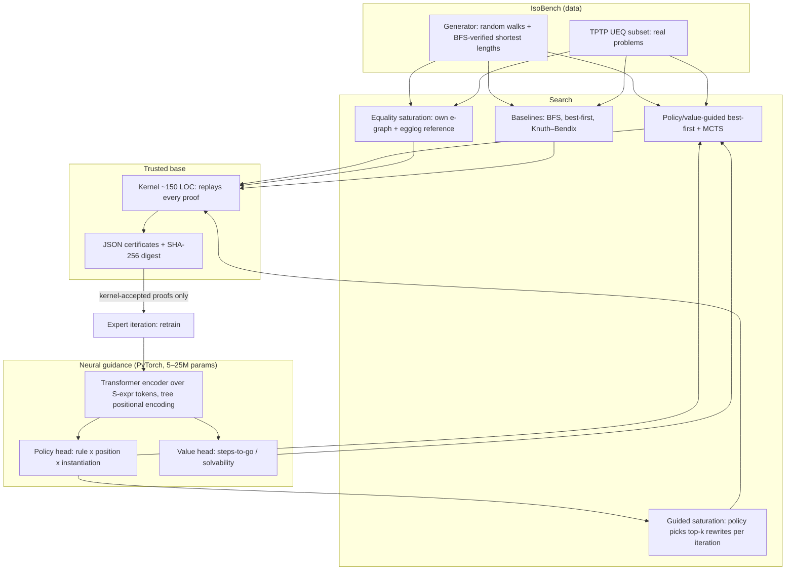

# Isomer — design document

> *Isomers* are molecules with the same formula and different structure.
> Isomer finds machine-checked proofs that two differently-shaped
> expressions are the same, using a small neural network to guide the search.

## 1. One-sentence claim (what the project must be able to defend)

**We show *what* a learned search heuristic for equational proving actually
computes, and use that understanding to predict when it will and won't
generalize to longer proofs than it was trained on.**

(Revised 2026-10-27 after a literature check: "neural guidance makes equality
saturation scale" is NOT new on its own -- see Section 8. The novelty has to
come from the generalization + interpretability angle, with guided search as
the testbed.)

Every number in the final write-up has to support or refute that sentence.
Components that don't serve it get cut.

## 2. The problem

Given axioms (e.g. the three left-axioms of a group) and two ground terms
`s` and `t`, find a sequence of rewrites turning `s` into `t`. Each step picks
(a) an axiom, (b) a direction, (c) a position, and sometimes (d) a brand-new
term for a variable the axiom introduces (`e -> (* (inv ?x) ?x)`: which `?x`?).
Choice (d) makes the action space infinite; that is the crux of the difficulty
and where learning has the most to add.

Why this domain (rather than copying a Lean 4 prover):

| Need | Lean prover | Isomer |
|---|---|---|
| Runs on an RTX 3050 laptop | Barely (toolchain + big models) | Yes: 5–25M param models, pure Python |
| Unlimited, perfectly-labelled training data | No | Yes: generator with known proofs |
| Controllable difficulty (for generalization studies) | Hard | Yes: walk length, term size, theory |
| Cheap independent verification | Lean kernel (heavy) | ~150-line kernel + differential tests |
| Strong non-neural baseline to beat honestly | ATPs | Equality saturation (egg/egglog), BFS, Knuth–Bendix |
| Real external benchmark | miniF2F etc. | TPTP **UEQ** (unit-equality) problems |
| Crowdedness | Very crowded (big labs) | Active but small: ML-guided e-graphs exist (mostly for optimisation); interpretability of learned prover heuristics looks open |

## 3. Research questions

* **RQ1 — Guidance vs saturation.** At matched compute *and* memory budgets,
  where does neural-guided search beat equality saturation, and where does it
  lose? (Expectation: saturation wins on short proofs; guidance wins once the
  e-graph explodes.)
* **RQ2 — Guided saturation (a method we build on, not a novelty claim).**
  Policy picks the top-k rewrites per e-graph iteration. Prior work already
  does RL/ML/LLM-guided rule selection (Omelette, MCTS-EqSat, Aurora, ML-guided
  EqSat, LGuess, CERES); we compare against that style fairly, on *proving*
  rather than optimisation.
* **RQ3 — Depth extrapolation.** Train on proofs of length ≤ 8, test on
  12/16/24. Which design choices help: tree-positional encodings vs flat
  RoPE, value head, expert iteration?
* **RQ4 — Self-improvement.** Does expert iteration (train on your own found
  proofs, re-verified by the kernel) push the solved frontier outward, and
  where does it plateau?
* **RQ5 — What did it learn? (interpretability; the headline).** Linear probes and
  activation patching on the value head: does it compute something like
  "rewrite distance to goal"? Can a discovered feature be turned back into
  a cheap hand-written heuristic (interpretability → engineering loop)?

## 4. System architecture

Principles:
1. **Nothing neural is trusted.** A proof counts only if the kernel accepts it.
2. **Small trusted base.** The kernel does not import the search engine; tests
   run both against each other (differential testing).
3. **Budget-matched comparisons.** Every method gets the same node-expansion
   budget *and* wall-clock *and* memory cap; all three are reported.
4. **Every component earns its place in an ablation table.**

## 5. Model (fits a 4 GB RTX 3050)

* Tokens: S-expression symbols (`(`, `)`, operators, constants). Input =
  `[current term] <sep> [goal term]`, max 256 tokens.
* Encoder: 6–8 layers, d=384, RMSNorm, SwiGLU, ~10–15M params, bf16.
* Tree positional encoding (path-from-root embedding) vs plain RoPE — an
  ablation, not a decision.
* Policy head: score each (position, rule) pair from the token at that
  position; instantiation for fresh variables chosen by pointing at a subterm
  (pointer network) — makes the infinite action space learnable.
* Value head: predicted remaining steps (regression, clipped) + solvable
  within budget (classification).

## 6. Evaluation plan

* **Splits:** in-distribution; longer proofs (depth extrapolation); bigger
  terms; held-out theory (train group+bool, test ring/lattice zero-shot);
  TPTP UEQ subset.
* **Metrics:** solve rate at budget B ∈ {50, 200, 1000} expansions;
  expansions-to-solve; wall-clock; peak memory; proof length vs shortest;
  pass@k for sampled search.
* **Statistics:** 3 seeds minimum, 95% bootstrap CIs, no cherry-picking —
  every run that was launched is logged.
* **Baselines:** BFS, size-heuristic best-first, Knuth–Bendix completion (where
  it terminates), equality saturation (own + egglog), and an ablated model with
  no value head.

## 7. Roadmap (≈10–12 weeks at 12–15 h/week)

| Phase | Deliverable | Exit criterion |
|---|---|---|
| 0 Setup | repo, CUDA env, CI, `doctor` | `pytest` green, GPU visible |
| 1 Core | terms, rewriting, kernel, certificates, generator v0 | differential tests pass ✅ (done) |
| 1b Data | generator v1 (BFS shortest length, dedup, splits), 2 more theories | IsoBench v0 frozen with a datasheet ✅ (code done; build locally) |
| 2 Baselines | BFS, best-first, own e-graph, egglog | first results table + plots |
| 3 Model | tokenizer, transformer, supervised training | policy top-1 > size heuristic |
| 4 Search | guided best-first, MCTS, guided saturation | RQ1/RQ2 table |
| 5 Self-play | expert iteration loop | solved-frontier curve |
| 6 Generalization | depth/size/theory splits + ablations | RQ3 table |
| 7 Interp | probes, patching, heuristic distilled from a feature | RQ5 section |
| 8 Ship | TPTP UEQ eval, write-up (arXiv style), demo, blog | someone else reproduces from README |

## 8. Prior work to read and position against

* Willsey et al., *egg: Fast and Extensible Equality Saturation* (POPL 2021).
* Wu et al., *INT: An Inequality Benchmark for Evaluating Generalization in
  Theorem Proving* (ICLR 2021) — closest in spirit for RQ3.
* Wang & Deng, *Learning to Prove Theorems by Learning to Generate Theorems*
  (NeurIPS 2020).
* Jakubův & Urban, *ENIGMA* — learned clause selection in the E prover.
* Polu & Sutskever, *GPT-f* (2020); Lample et al., *HyperTree Proof Search*
  (2022) — search + learned policy/value.
* TPTP library, UEQ division; Waldmeister / Twee (strong equational provers).

ML-guided equality saturation / neural equational proving (must cite, must
compare against where possible):
* Singh, *Deep RL for Equality Saturation* ("Omelette"), Cambridge MPhil 2022.
* Hartmann, *MCTS for Equality Saturation*, Cambridge MPhil 2023.
* Aurora: *Learned Graph Rewriting with Equality Saturation* (arXiv 2407.12794).
* Koehler/Steuwer et al., *Guided Equality Saturation* (POPL 2024); Heinimann
  et al., *Machine Learning Guided Equality Saturation* (EGRAPHS @ PLDI 2025).
* Peng, Ji, Xiong, *Equality Saturation Guided by LLMs* ("LGuess", arXiv 2511.00403).
* *CERES: Making Equality Saturation Memory-Scalable* (EGRAPHS @ PLDI 2026).
* *LLM-Guided Strategy Synthesis for Scalable Equality Saturation* (arXiv 2604.17364).
* Piepenbrock, Heskes, Janota, Urban, *Guiding an ATP with Neural Rewriting*
  (IJCAR 2022): RL-trained rewriter beats Waldmeister on AIM -- the closest
  prior work to Isomer's proving setting.

Interpretability of algorithmic transformers (methods to borrow):
* Palumbo et al., *Mechanistically interpreting a transformer 2-SAT solver* (2024).
* Gross et al., *Compact Proofs of Model Performance via Mech Interp* (2024).

Positioning: we are not trying to beat state-of-the-art provers on TPTP. We
study a specific, testable question (what learned proof-search guidance
encodes, and whether that predicts its length generalization) with a fully
reproducible setup. Before any write-up, re-run the literature search: this
area moves fast and a novelty claim must be checked against the latest arXiv.

## 9. Honesty rules for the write-up

* Report failures and the regime where baselines win.
* Walk length is an upper bound on proof length; say so when it matters.
* Do not claim "verified" for anything the kernel did not check.
* Every figure is regenerated by one command from logged runs.
